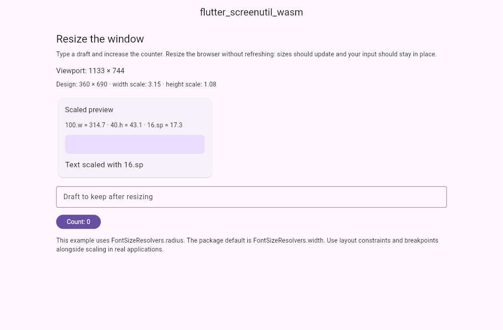

# flutter_screenutil_wasm

[中文文档](README_CN.md) · [Example](example/README.md) · [Contributing](CONTRIBUTING.md)

Screen and font scaling for Flutter, based on
[flutter_screenutil 5.9.3](https://pub.dev/packages/flutter_screenutil/versions/5.9.3),
with stack-safe resize traversal for Flutter Web Wasm builds. This is an
independent fork, not an official upstream release. It can also be used in
ordinary JS Web builds and non-Web Flutter applications.



## Why this fork exists

In a reproduced Chrome Release Wasm case, resizing the window caused
`RangeError: Maximum call stack size exceeded` during recursive Element-tree
traversal in `ScreenUtilInit`. The view could stay at its previous size until
the page was refreshed, while debug Wasm or Release JS behaved differently.

This fork replaces that traversal with an explicit stack. It preserves the
original parent-first, left-to-right order, synchronous execution, widget
identity and rebuild filtering. It does not change the scaling formulas or
reset the application with new keys. Traversal still takes O(N) work; the patch
does not remove the cost of scanning or rebuilding the widget tree.

## Installation

For a published release, add:

```yaml
dependencies:
  flutter_screenutil_wasm: ^5.9.3
```

For a local checkout before publication, use a path dependency instead:

```yaml
dependencies:
  flutter_screenutil_wasm:
    path: ../flutter_screenutil_wasm
```

The initial fork version is **5.9.3**, matching the upstream base. Package
constraints remain Dart `>=2.17.0 <4.0.0` and Flutter `>=3.10.0`. Verification has
been performed with Flutter 3.44.9 / Dart 3.12.2 and Chrome 155; the minimum SDK
and every native device platform have not been independently tested. Wasm build
and browser support depend on your Flutter SDK and browser.

## Quick start

```dart
import 'package:flutter/material.dart';
import 'package:flutter_screenutil_wasm/flutter_screenutil_wasm.dart';

void main() => runApp(
      ScreenUtilInit(
        designSize: const Size(360, 690),
        fontSizeResolver: FontSizeResolvers.radius,
        builder: (context, child) => MaterialApp(home: child),
        child: const ExamplePage(),
      ),
    );

class ExamplePage extends StatelessWidget {
  const ExamplePage({super.key});

  @override
  Widget build(BuildContext context) {
    return Scaffold(
      body: Center(
        child: SizedBox(
          width: 240.w,
          child: Text('Resize the window', style: TextStyle(fontSize: 16.sp)),
        ),
      ),
    );
  }
}
```

Set `designSize` to the logical dimensions of your design, not the current
window size. Read scaled values after initialization, inside a widget build;
avoid caching them in top-level or static variables.

## Common APIs

| API | Meaning |
| --- | --- |
| `100.w` | Design width multiplied by the width scale |
| `40.h` | Design height multiplied by the height scale |
| `8.r` | Value multiplied by the smaller width/height scale |
| `16.sp` | Font size calculated by the configured resolver |
| `0.5.sw`, `0.5.sh` | Fraction of the current logical view width/height |
| `16.horizontalSpace`, `16.verticalSpace` | Scaled `SizedBox` spacing |
| `ScreenUtil().screenWidth`, `.screenHeight` | Current logical view dimensions |
| `RPadding`, `REdgeInsets`, `RSizedBox` | Retained upstream layout helpers |

**Font scaling:** `ScreenUtilInit` defaults to `FontSizeResolvers.width`, also
when `minTextAdapt: true` is supplied. Choose `FontSizeResolvers.radius`
explicitly, as in the example, if fonts should use the smaller scale. This fork
does not change that upstream behavior. Flutter's system text scaling still
applies to `Text`; the example does not disable accessibility settings.

Scaling is not a replacement for responsive structure. Use `LayoutBuilder`,
constraints and breakpoints when a narrow layout should differ from a wide
one. Existing upstream type-name-based rebuild filtering is retained.

## Migrating from flutter_screenutil

1. Replace the dependency with `flutter_screenutil_wasm`.
2. Replace every import of
   `package:flutter_screenutil/flutter_screenutil.dart` with
   `package:flutter_screenutil_wasm/flutter_screenutil_wasm.dart`.
3. Run `flutter pub get` and inspect `flutter pub deps`. Make sure initialization
   and size extensions all use this fork, including imports in local packages.

The two package names identify different Dart libraries, types and singletons.
Do not initialize one package and use extensions from the other. A third-party
package still importing the original requires its own migration or another
explicit integration decision; this fork cannot transparently alias it.

Public API symbols are retained from 5.9.3. This is a focused patch to the resize
traversal, not a general fix for all Web/Wasm or upstream issues. Other recursive
paths, including experimental `ScreenUtil.registerToBuild(context, true)`, are
unchanged. The legacy `textScaleFactor` getter is retained for source and
behavior compatibility.

## Run the example and regressions

The [interactive example](example/README.md) shows live `.w`/`.h`/`.sp` values,
a scaled preview, a draft field and a counter. Resize without refreshing to
check that state is retained.

From the package root:

```sh
flutter pub get
flutter test --concurrency=1
cd example
flutter pub get
flutter run -d chrome --wasm
```

Debug success alone does not validate this issue. Build and serve the Release
Wasm output as described in the example README. The
[contributor guide](CONTRIBUTING.md) also explains the automated Release
Wasm/JS regression: three nesting depths and 48 resize operations, checking
rendered dimensions, font size, view bounds, retained State and uncaught errors.

## Source and license

- Fork: https://github.com/2697a/flutter_screenutil_wasm
- Upstream: https://github.com/OpenFlutter/flutter_screenutil
- [Fork changelog](CHANGELOG.md) · [Preserved upstream changelog](doc/UPSTREAM_CHANGELOG.md)
- Apache-2.0: [LICENSE](LICENSE) and [NOTICE](NOTICE). Original attribution
  notices are retained; modified library files identify the fork changes.
